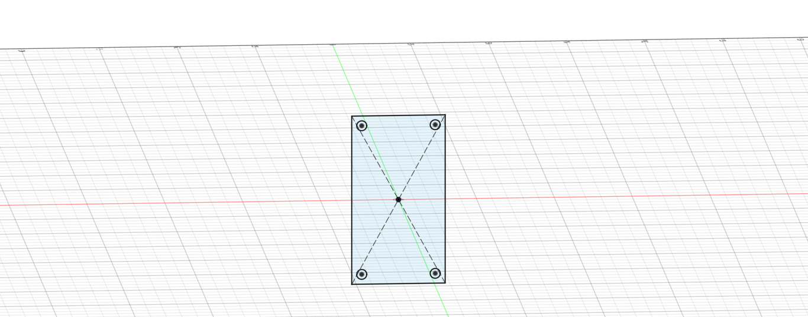

# Day 1: Project Kickoff, The 30-Day Constraint & Fusion 360 Basics

- **Date:** 19 November 2026
- **Phase:** Foundations & CAD Fundamentals
- **Focus:** Setting up version control, learning Fusion 360 2D sketching constraints, and evaluating project ambitions.

---

## 1. Context & Starting Constraints

The project started with a 30-day free subscription to **Autodesk Fusion 360**. With a strict calendar clock running, the goal was set: use this 30-day window to learn parametric CAD from scratch, combine it with embedded systems and software, and document the entire engineering journey transparently on GitHub.

| Constraint | Detail |
| :--- | :--- |
| **Time Window** | 30 days (Fusion 360 active window) |
| **Core Domains** | Mechanical CAD, Embedded Systems (C++), RF Communications, Web Dashboard |
| **Documentation** | Daily committed build logs + reproducible open-source documentation |
| **Deliverable** | Full 3D printable CAD model + working firmware & dashboard prototype |

---

## 2. Autodesk Fusion 360 Setup & Navigation

Before drawing any geometry, the modeling environment was configured for engineering tolerances:
- **Default Units:** Switched from Imperial to **Millimeters (mm)** under *Preferences > Default Units > Design*. All physical enclosures and 3D printing workflows depend on metric standards.
- **Canvas Navigation:** Mastered the 3 core viewport controls:
  - **Orbit:** `Shift` + Middle Mouse Button drag to rotate around the 3D target.
  - **Pan:** Middle Mouse Button drag to slide the view.
  - **Zoom:** Scroll wheel.

---

## 3. Parametric 2D Sketching Fundamentals

Completed the first foundational exercise in 2D sketching to understand how parametric modeling engines resolve geometry:

1. **Origin Anchor:** Every sketch must be anchored to the global Origin `(0,0,0)` to eliminate floating translation errors.
2. **Geometric Constraints over Raw Dimensions:** Learned to use geometric rules (Coincident, Horizontal/Vertical, Equal, Collinear) to define relationships before typing in numbers.
3. **Degrees of Freedom (Blue vs. Black):**
   - **Blue lines:** Under-constrained (can be accidentally dragged and distorted).
   - **Black lines:** Fully constrained (zero remaining degrees of freedom, locked in space and size).

### Practice Artifact
A practice mounting plate was designed to test hole pattern constraints and symmetry:
- Plate footprint: `55 mm x 30 mm`
- 4× corner clearance holes: `3.2 mm` (standard M3 screw clearance)
- Offset from edges: `3.0 mm`
- All geometry constrained until fully black.

*Figure 1: Fully constrained 2D sketch practice in Autodesk Fusion 360.*

---

## 4. The Reflection & Ideation Need

While the CAD exercise was successful, reflecting on the initial project concept (a smart desk controller) revealed a critical gap:
- It was a classic "novelty gadget" without a real beneficiary.
- It lacked narrative depth, technical challenge, and demonstrable urgency.

**Decision:** Before sinking 30 days of mechanical modeling and firmware into a toy project, Day 2 will be dedicated entirely to an unconstrained, structured ideation and research session to identify a real-world, high-stakes problem that can be solved with an IoT hardware node.
