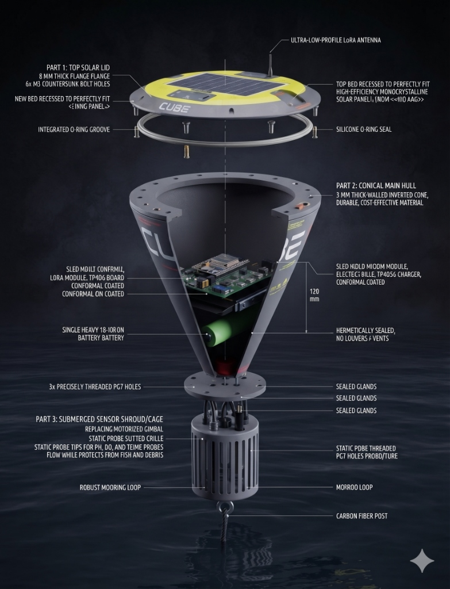

# Day 3: Mechanical Architecture Blueprint & Conical Hull Design

- **Date:** 21 November 2026
- **Phase:** Mechanical Engineering & CAD Planning
- **Focus:** Finalizing the 3-part modular buoy architecture, establishing water-tight sealing specifications, and setting up the Fusion 360 parametric master model.

---

## 1. Approved Architecture Blueprint

Following yesterday's systems research, the physical architecture for the **PondSense** buoy was finalized and rendered into a detailed exploded-view mechanical specification.

*Figure 1: Final exploded mechanical blueprint of the PondSense aquaculture buoy.*

---

## 2. The 3-Part Modular Breakdown

The design solves three foundational marine engineering challenges: **positive self-righting stability**, **IP67 hermetic sealing**, and **modular electronics serviceability**.

### Part 1: Top Solar Lid
- **Sun & RF Deck:** Recessed upper bed engineered to hold a standard high-efficiency monocrystalline solar panel flush with the deck.
- **RF Transmission:** Center-mounted ultra-low-profile LoRa antenna (865 MHz) extending vertically to maximize line-of-sight range over water.
- **Sealing Interface:** 8 mm thick flange with 6× M3 countersunk bolt holes and an integrated silicone O-ring retention groove.

### Part 2: Conical Main Hull (Flotation Body)
- **Geometry:** 120 mm tall inverted cone with a 3 mm uniform wall thickness (optimized for watertight 3D printing in PETG).
- **Inverted Cone Physics:** The tapered lower geometry naturally funnels ballast to the lowest point, positioning the Center of Gravity ($CG$) well below the Center of Buoyancy ($CB$) to eliminate capsizing risks.
- **Modular Internal Sled:** Internal slide rails retain a removable electronics tray carrying:
  - ESP32-WROOM-32 DevKit
  - SX1276 LoRa transceiver module
  - TP4056 solar charge controller + 5V regulator
  - pH and Turbidity analog signal conditioning boards
- **Ballast / Energy Core:** Single 18650 Li-ion cell (~48g) anchored at the lowest apex of the cone.
- **Bulkhead Penetrations:** Bottom plate featuring 3× threaded holes for standard PG7 cable glands.

### Part 3: Submerged Sensor Shroud / Protective Cage
- **Vented Grille:** Heavy-duty slotted cage that screws or snaps directly beneath the bottom bulkhead plate.
- **Protection:** Prevents pond weeds, debris, and fish from striking or fouling the sensitive glass pH bulb and DO membrane.
- **Free Flow:** Large longitudinal slots ensure continuous, uninhibited water exchange across the probes for real-time measurements.
- **Mooring Interface:** Molded lower eyelet to tether the buoy to a bank-anchored line or bottom weight.

---

## 3. Engineering Parameter Specifications

| Parameter | CAD Variable | Target Value | Engineering Purpose |
| :--- | :--- | :--- | :--- |
| **Flange Outer Diameter** | `lid_od` | `136 mm` | Provides 8 mm perimeter for M3 screw circle |
| **Upper Cone Diameter** | `cone_top_dia` | `120 mm` | Primary flotation displacement volume |
| **Hull Total Height** | `hull_height` | `120 mm` | Ensures sufficient freeboard above waterline |
| **Lower Bulkhead Diameter** | `base_dia` | `60 mm` | Accommodates 3× PG7 cable glands ($12.5\text{ mm}$ thread each) |
| **Wall Thickness** | `wall_thickness` | `3.0 mm` | Minimum 7 perimeters for leak-free PETG printing |
| **Bolt Circle Diameter (PCD)** | `pcd_m3` | `128 mm` | Equidistant 60° spacing for 6× M3 clamping bolts |
| **O-Ring Groove Width / Depth** | `oring_w` / `oring_d` | `3.2 mm` / `2.0 mm` | 30% compression on a $2.5\text{ mm}$ round silicone cord |

---

## 4. Next Steps (Day 4)
- Model **Part 2 (Conical Main Hull)** in Fusion 360 using the parametric Revolve tool.
- Model the **Part 1 Top Lid** with the recessed solar pocket and countersunk hole pattern.
- Begin firmware scaffolding in PlatformIO / Arduino framework for the ESP32 node.
